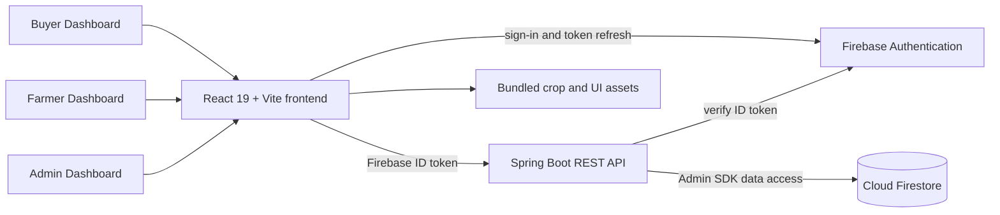
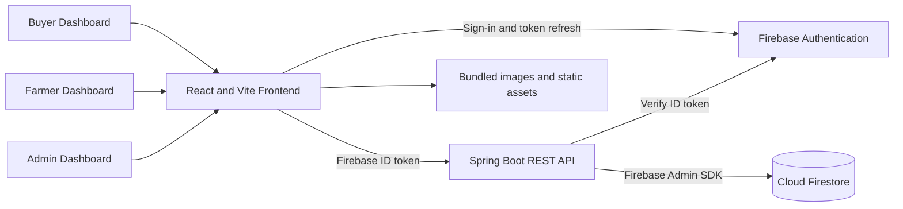
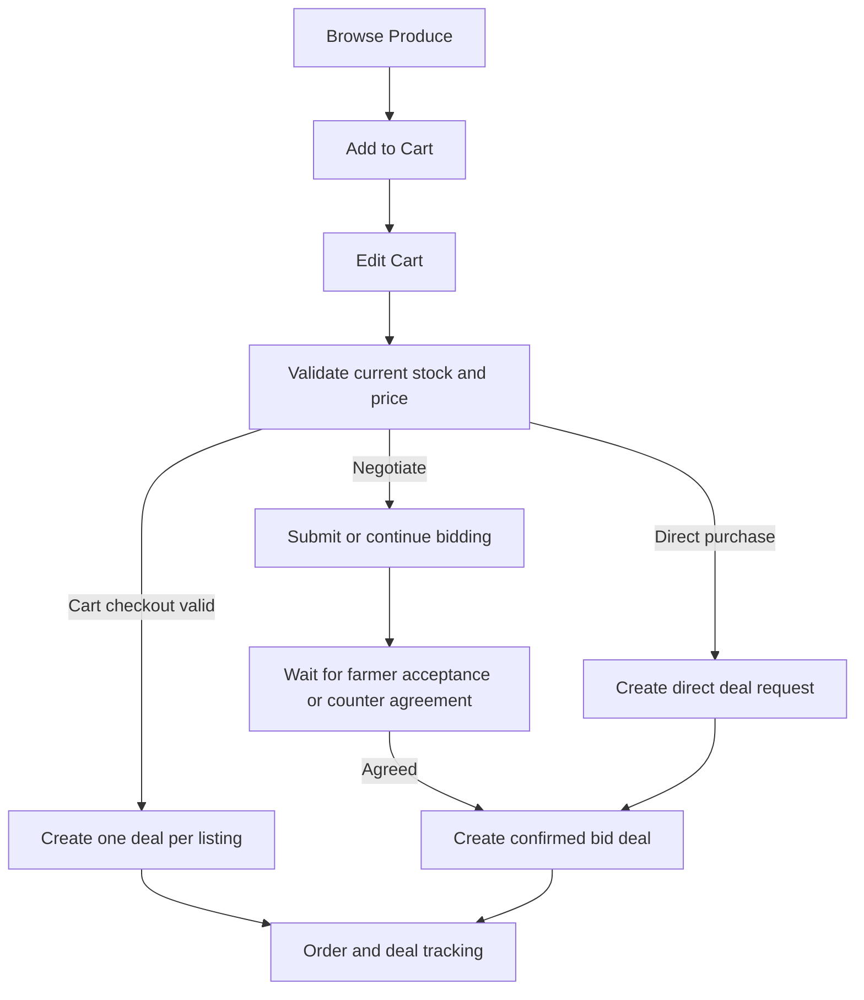
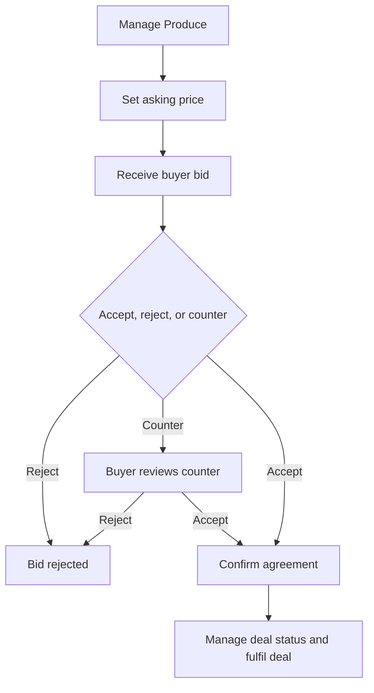
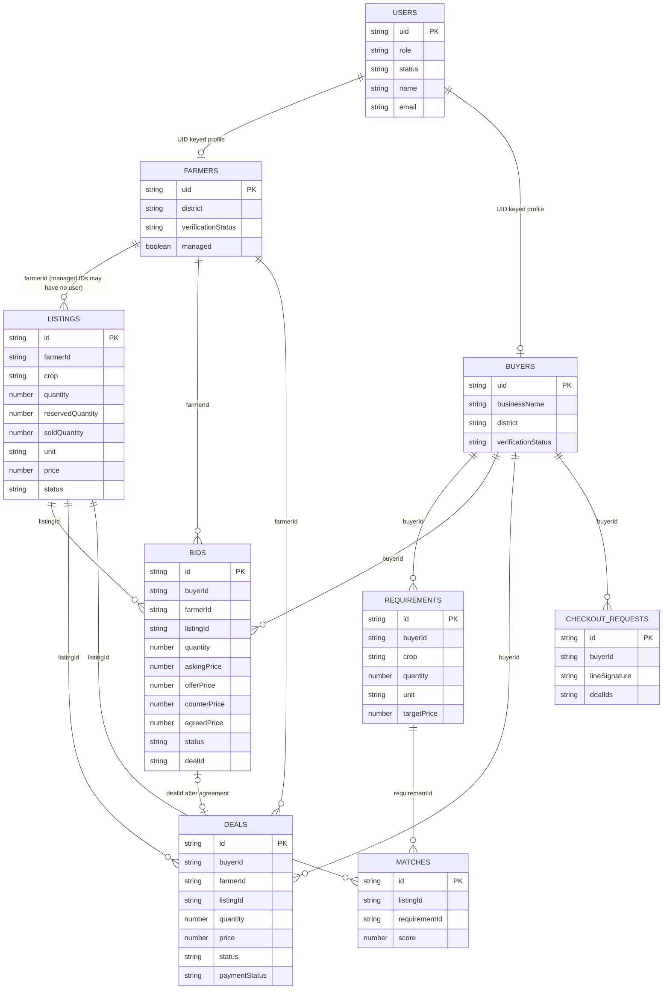
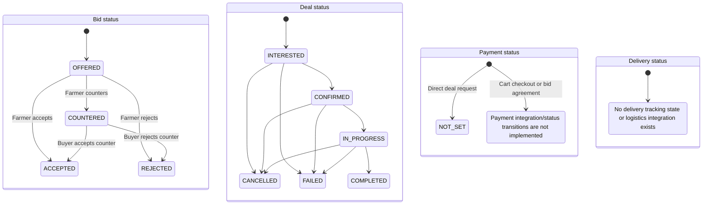
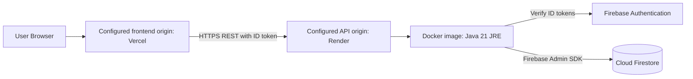

# RaithaMarga Project Documentation

This document describes the frontend in this repository and the REST API in the adjacent `../RaithaMarga-backend` repository. It reflects the source inspected in both worktrees; it does not imply that a configured external deployment is currently healthy.

## 1. Project overview and objectives

RaithaMarga is a farmer-to-buyer agricultural marketplace. It provides a public produce discovery site and authenticated dashboards for farmers, buyers, and administrators. The product is designed to make local produce listings, buyer demand, negotiation, and deal progress easier to see.

The frontend is a React single-page application. It uses Firebase Authentication for sign-in and sends Firebase ID tokens to a Spring Boot API. The API uses the Firebase Admin SDK and Cloud Firestore for application data.

## 2. Problem statement and target users

Small and marginal farmers can have difficulty finding verified buyers and negotiating transparent prices. Buyers need a way to find available produce, express demand, and manage procurement.

The application's user groups are:

- **Farmers:** create produce listings, see matches, negotiate offers, and manage deals.
- **Buyers:** browse produce, publish requirements when verified, maintain a cart, place direct deal requests, negotiate bids, and track deals.
- **Administrators:** verify profiles, manage accounts and team-added farmers, inspect marketplace records, and review audit activity.
- **Team-assisted farmers:** farmers entered by an administrator who do not have a Firebase login. Their listings are visible, but they cannot sign into the farmer dashboard or receive bids through the logged-in farmer flow.

## 3. Verified technology stack

| Area | Verified implementation |
| --- | --- |
| Frontend | React 19, JavaScript/JSX, Vite 8, React Router 7 |
| Client authentication | Firebase Authentication JavaScript SDK 12 |
| API | Java 21, Spring Boot 3.4, REST/JSON, Jakarta Bean Validation |
| Backend Firebase integration | Firebase Admin SDK 9.4; Cloud Firestore |
| Frontend tests | Node.js built-in test runner (`node --test`) |
| Frontend lint/build | ESLint; Vite production build |
| Backend tests | Spring Boot test dependency and JUnit tests under `src/test` |
| Container | Backend Dockerfile builds a Java 21 container image |

The frontend does not directly read or write Firestore. Firebase client code initializes Authentication; application records are accessed through the backend API.

## 4. Project folder structure

The active frontend root is this repository. The backend is maintained separately in the sibling `RaithaMarga-backend` repository. Dependency folders and generated build output (`node_modules/`, `dist/`, and `target/`) are omitted below.

```text
RaithaMarga/
├── .env.example
├── .gitignore
├── eslint.config.js
├── index.html
├── LICENSE
├── package.json
├── package-lock.json
├── README.md
├── vite.config.js
├── public/
│   ├── favicon.png
│   ├── favicon.svg
│   └── icons.svg
├── src/
│   ├── App.jsx
│   ├── App.css
│   ├── index.css
│   ├── main.jsx
│   ├── assets/
│   │   ├── hero.png
│   │   ├── login-bg-field.jpg
│   │   ├── logo-emblem-raw.png
│   │   ├── logo-emblem.png
│   │   ├── logo-full-square.png
│   │   ├── logo-full.png
│   │   ├── logo-mark.png
│   │   ├── logo-seal.png
│   │   ├── react.svg
│   │   ├── vite.svg
│   │   ├── features/
│   │   │   ├── buyers-active-today.jpg
│   │   │   ├── know-your-buyer.jpg
│   │   │   ├── list-without-typing.jpg
│   │   │   ├── sell-together.jpg
│   │   │   ├── weight-proof.jpg
│   │   │   └── whatsapp-sell.svg
│   │   ├── how-it-works/
│   │   │   ├── 01_list_in_seconds.png
│   │   │   ├── 02_combined_matched.png
│   │   │   ├── 03_verified_buyer.png
│   │   │   ├── 04_deliver_get_paid.svg
│   │   │   └── 04_weigh_deliver_get_paid.png
│   │   └── images/
│   │       ├── fruits/ (apple, banana, grapes, guava, jackfruit, lemon,
│   │       │           mango, orange, papaya, pineapple, pomegranate,
│   │       │           watermelon; JPG files)
│   │       └── vegetables/ (beans, brinjal, cabbage, carrot, cauliflower,
│   │                       cucumber, green-chilli, okra, onion, potato,
│   │                       spinach, tomato; JPG files)
│   ├── components/
│   │   ├── CropCard.jsx
│   │   ├── CropImage.jsx / CropImage.css
│   │   ├── CropShowcase.jsx / CropShowcase.css
│   │   ├── ProtectedRoute.jsx
│   │   ├── AgriBackdrop/ (AgriBackdrop.jsx, AgriBackdrop.css)
│   │   ├── ContactSection/ (ContactSection.jsx, ContactSection.css)
│   │   ├── Features/ (Features.jsx, Features.css)
│   │   ├── FinalCta/ (FinalCta.jsx, FinalCta.css)
│   │   ├── Footer/ (Footer.jsx, Footer.css)
│   │   ├── Hero/ (Hero.jsx, Hero.css)
│   │   ├── HowItWorks/ (HowItWorks.jsx, HowItWorks.css)
│   │   ├── Impact/ (Impact.jsx, Impact.css)
│   │   ├── Navbar/ (Navbar.jsx, Navbar.css)
│   │   ├── SellOnWhatsApp/ (SellOnWhatsApp.jsx, SellOnWhatsApp.css)
│   │   ├── TrustBar/ (TrustBar.jsx, TrustBar.css)
│   │   ├── camera/ (LiveCameraCapture.jsx, LiveCameraCapture.css)
│   │   └── dashboard/
│   │       ├── EmptyState.jsx
│   │       ├── icons.jsx
│   │       ├── ListingDetailModal.jsx
│   │       ├── ListingImage.jsx
│   │       ├── MakeOfferModal.jsx
│   │       ├── MarketplaceDeals.jsx
│   │       ├── PhotoPlaceholder.jsx
│   │       ├── StatCard.jsx
│   │       ├── StatusBadge.jsx
│   │       ├── VerificationNotice.jsx
│   │       ├── WhatsAppCard.jsx
│   │       ├── WhatsAppIcon.jsx
│   │       └── dashboard-ui.css
│   ├── config/whatsapp.js
│   ├── context/
│   │   ├── AdminDataContext.jsx
│   │   ├── AuthContext.jsx
│   │   ├── BuyerDataContext.jsx
│   │   ├── FarmerDataContext.jsx
│   │   ├── LanguageContext.jsx
│   │   ├── auth-context.js
│   │   └── useAuth.js
│   ├── data/
│   │   ├── crops.js
│   │   └── storageKeys.js
│   ├── hooks/
│   │   ├── useAdminResource.js
│   │   ├── useCountUp.js
│   │   ├── useLocalStorage.js
│   │   ├── useMarketplaceListings.js
│   │   ├── useReveal.js
│   │   └── useStoredDeals.js
│   ├── i18n/translations.js
│   ├── layouts/DashboardLayout/
│   │   ├── DashboardLayout.jsx
│   │   └── DashboardLayout.css
│   ├── lib/
│   │   ├── adminApi.js
│   │   ├── api.js
│   │   ├── assistedFarmers.js
│   │   ├── cart.js
│   │   ├── firebase.js
│   │   ├── listingIds.js
│   │   ├── marketplace.js
│   │   └── verification.js
│   ├── pages/
│   │   ├── Crops.jsx / Crops.css
│   │   ├── Home.jsx
│   │   ├── Login.jsx / Login.css
│   │   ├── Register.jsx / Register.css
│   │   ├── admin/
│   │   │   ├── AdminAddFarmer.jsx
│   │   │   ├── AdminAudit.jsx
│   │   │   ├── AdminDashboard.jsx
│   │   │   ├── AdminDashboardShell.jsx
│   │   │   ├── AdminFeedback.jsx
│   │   │   ├── AdminMarketplace.jsx
│   │   │   ├── AdminOverview.jsx
│   │   │   ├── AdminShell.jsx
│   │   │   ├── AdminUsers.jsx
│   │   │   ├── AdminVerifications.jsx
│   │   │   ├── admin-dashboard.css
│   │   │   ├── admin.css
│   │   │   ├── adminFormat.js
│   │   │   └── adminUtils.js
│   │   ├── buyer/
│   │   │   ├── BrowseProduce.jsx
│   │   │   ├── BuyerDashboardShell.jsx
│   │   │   ├── Cart.jsx
│   │   │   ├── Deals.jsx
│   │   │   ├── MyBids.jsx
│   │   │   ├── Overview.jsx
│   │   │   ├── Profile.jsx
│   │   │   ├── RecommendedMatches.jsx
│   │   │   ├── RequestsOrders.jsx
│   │   │   └── TrustVerification.jsx
│   │   └── farmer/
│   │       ├── AccountDetails.jsx
│   │       ├── AddProduce.jsx
│   │       ├── BuyerMatches.jsx
│   │       ├── FarmerDashboardShell.jsx
│   │       ├── IncomingBids.jsx
│   │       ├── MyDeals.jsx
│   │       ├── MyListings.jsx
│   │       ├── Overview.jsx
│   │       ├── Profile.jsx
│   │       └── Verification.jsx
│   └── styles/global.css
├── tests/cart.test.js
└── my-project/
    ├── package.json
    ├── package-lock.json
    └── my-app/
        ├── .gitignore
        ├── .oxlintrc.json
        ├── README.md
        ├── index.html
        ├── package.json
        ├── package-lock.json
        ├── vite.config.js
        ├── public/ (favicon.svg, icons.svg)
        └── src/ (App.jsx, App.css, index.css, main.jsx,
                  assets/hero.png, assets/react.svg, assets/vite.svg)

RaithaMarga-backend/
├── .env.example
├── .gitignore
├── DOC-20261001-WA0001.pdf
├── Dockerfile
├── LICENSE
├── pom.xml
├── README.md
└── src/
    ├── main/
    │   ├── java/com/raithamarga/backend/
    │   │   ├── RaithaMargaApplication.java
    │   │   ├── config/FirebaseConfig.java
    │   │   ├── controller/ (AdminController, AdminFarmerController,
    │   │   │               BidController, DealController, ListingController,
    │   │   │               MatchController, PublicController,
    │   │   │               RequirementController, UserController)
    │   │   ├── dto/ApiDtos.java
    │   │   ├── exception/ (ApiException, GlobalExceptionHandler)
    │   │   ├── model/ (DealStatus, UserRole)
    │   │   ├── repository/FirestoreRepository.java
    │   │   ├── security/ (Actor, FirebaseAuthenticationFilter)
    │   │   └── service/ (AdminService, BidService, ContactService,
    │   │                  DataValues, DealService, DealStatusMachine,
    │   │                  ListingService, ManagedFarmerService,
    │   │                  MatchingService, RequirementService, UserService)
    │   └── resources/application.yml
    └── test/java/com/raithamarga/backend/service/
        (AdminServiceTest, DealServiceTest, DealStatusMachineTest,
         ManagedFarmerServiceTest, MatchingServiceTest)
```

The active root frontend is configured by its own `package.json`, `vite.config.js`, and `src/main.jsx`. `my-project/` is an additional nested starter directory, not the application served by the root scripts.
An optional local `.env.local` file is intentionally not listed or documented; never commit private environment values.

## 5. Architecture and component relationships

`App.jsx` declares the public routes and protected dashboards. `AuthProvider` observes Firebase Authentication and calls `/api/me` to load the server-owned role. Buyer, farmer, and admin contexts provide dashboard data and actions. `lib/api.js` attaches the current Firebase ID token to protected API requests. The Spring Boot controllers delegate to services, which enforce role/ownership rules and use `FirestoreRepository` or Firestore transactions.



The frontend does not have a direct Firestore client data path. Crop photographs are bundled frontend assets or fallbacks; no Firebase Storage upload service is implemented in the backend.

## 6. Routing and dashboard structure

The router is defined in `src/App.jsx`.

| Route | Access | Page |
| --- | --- | --- |
| `/` | Public | Home/landing page |
| `/crops` | Public | Crop availability and showcase |
| `/login`, `/register`, `/get-started` | Public | Authentication and account setup |
| `/buyer/dashboard` | Buyer | Buyer overview |
| `/buyer/dashboard/browse` | Buyer | Active produce listings and cart/offer actions |
| `/buyer/dashboard/cart` | Buyer | UID-scoped cart and checkout |
| `/buyer/dashboard/bids` | Buyer | Submitted bids and counter-offer responses |
| `/buyer/dashboard/recommended` | Buyer | Requirement/listing matches |
| `/buyer/dashboard/requests`, `/buyer/dashboard/deals` | Buyer | Requests and deal tracking |
| `/buyer/dashboard/profile` | Buyer | Buyer profile/requirements |
| `/farmer/dashboard` | Farmer | Farmer overview |
| `/farmer/dashboard/add-produce`, `/listings` | Farmer | Create and view listings |
| `/farmer/dashboard/matches` | Farmer | Buyer/listing matches |
| `/farmer/dashboard/bids` | Farmer | Incoming bid actions |
| `/farmer/dashboard/deals` | Farmer | Deal status management |
| `/farmer/dashboard/account`, `/profile` | Farmer | Farmer account/profile pages |
| `/admin/dashboard` and nested admin paths | Admin | Overview, verification, users, team-added farmers, marketplace, audit |

`ProtectedRoute` checks authentication and the frontend role before rendering each role dashboard. The API independently verifies identity and authorization; client-side route protection is not the security boundary.

## 7. Authentication and authorization

1. The frontend signs users in using Firebase Authentication (email/password flows are implemented).
2. It sends the Firebase ID token in the `Authorization: Bearer …` header to protected `/api/*` endpoints.
3. `FirebaseAuthenticationFilter` verifies the token and derives the actor UID, email, and display name from the verified token.
4. `UserService` reads or initializes `users/{uid}` and returns the role/profile. Backend services check role, account status, profile verification, and relationship ownership as required.
5. `ProtectedRoute` provides dashboard navigation UX, but backend service checks remain authoritative.

Buyer requirements, direct deals, checkout, and bids require a manually verified buyer profile. Farmers can only update bids and deals where their authenticated UID is the recorded farmer party. Team-added farmers have no login; administrators manage their records.

## 8. Firebase services, collections, and data models

The backend uses Cloud Firestore collections and string document IDs. Business records refer to other records with UID/listing/deal ID fields; these are not nested subcollections or Firestore `DocumentReference` fields. Checkout receipts embed a list of deal ID strings.

| Collection | Purpose and observed fields |
| --- | --- |
| `users` | UID-keyed identity/role record: `uid`, `name`, `email`, `role`, `status`, timestamps |
| `farmers` | UID-keyed farmer profile: village, taluk, district, state, land area, verification status, timestamps; team-added farmers use managed IDs |
| `buyers` | UID-keyed buyer profile: business name, district, verification status, timestamps |
| `listings` | Produce listing: farmer ID/name, crop, quantity, reserved/sold quantities, unit, grade, price, location, availability date, status, timestamps; managed listings may have a managed farmer ID |
| `requirements` | Buyer demand: buyer ID, crop, quantity, unit, quality, location, target price, status and timestamps |
| `matches` | Computed match records referencing listing and requirement IDs, with score/reasons |
| `bids` | Buyer-farmer negotiation: buyer/farmer IDs and display names, listing ID, crop/unit, quantity, asking price, offer price, optional counter/agreed price, status, timestamps, optional deal ID |
| `deals` | Deal/order: buyer/farmer/listing IDs, crop/unit snapshot where available, quantity, unit price, status, payment status where set, timestamps |
| `checkoutRequests` | Idempotency receipt keyed by buyer UID plus client key; stores buyer ID, request signature, created deal IDs, and creation timestamp |
| `auditLogs` | Administrative and managed-farmer activity records |
| `contactMessages` | Validated public contact form submissions; no email/WhatsApp dispatch is configured |

The cart is **not** a Firestore collection. It is stored in browser `localStorage` under a key scoped by the Firebase buyer UID. This preserves cart lines across refreshes and sign-in sessions in the same browser, but does not synchronize a buyer's cart across browsers/devices.

No Firestore security-rules file is present in the inspected repositories. The backend uses the Firebase Admin SDK, so Firestore access control is implemented in authenticated API filters and service-level role/ownership/validation checks; Admin SDK calls do not rely on end-user Firestore rules.

## 9. Produce listing lifecycle

An authenticated farmer submits a validated listing through `POST /api/listings`. The backend binds the listing to the caller's UID, initializes reservation/sold quantities, checks the listing district against the farmer profile, and creates it as `ACTIVE`. Buyer listing reads expose currently available quantity and omit farmer phone numbers. Team-added farmers and their listings are created/managed by the admin API.

The API currently supports listing creation and reads; a general farmer listing-edit endpoint is not present in the inspected `ListingController`. Inventory is reduced from available stock by reservation and updated when a deal completes or is cancelled.

## 10. Buyer cart lifecycle

1. Buyers add eligible backend listings from Browse Produce or Recommended Matches.
2. Adding a listing updates an existing line for the same listing ID rather than creating duplicate lines; each line keeps quantity, expected price, farmer/crop display data, and the stock snapshot shown at addition.
3. The cart is persisted per buyer UID in local storage. It can contain more than 50 lines; no artificial two- or three-line cap is used.
4. Buyers can edit quantity, remove a line, view line totals/subtotal, and open an offer from an eligible cart line. Cart changes do not reserve stock.
5. The frontend uses a buyer-scoped, persisted checkout idempotency key for an unchanged cart on retries. The backend also records a receipt for that key.
6. The backend validates every listing's active status, current price, and available stock in a single Firestore transaction before writing any deal or reservation. A validation failure aborts that transaction, so the checkout does not partially create deals.
7. A successful checkout creates one deal per listing and reserves quantity. It is not a payment; the checkout-created deals start with payment status `PENDING`.

The backend currently accepts at most 100 distinct lines per checkout request, matching the DTO validation and leaving room under Firestore transaction write limits, including managed-listing audit writes. The cart itself is not capped at 100; a buyer must check out smaller batches if it contains more than 100 lines.

Local seed/demo listings are not present in backend Firestore and are marked unavailable for checkout.

## 11. Direct purchase workflow

The existing “I'm Interested” action is separate from cart checkout. It calls `POST /api/deals` with a listing ID, quantity, and price. The backend checks buyer verification, listing status, ownership, and stock, then creates an `INTERESTED` deal and reserves quantity immediately. The cart flow does not use this endpoint; cart checkout creates all its deals through `POST /api/deals/checkout`.

Neither flow charges a payment method. Deal status and payment status are distinct.

## 12. Bid, counter-offer, and agreement lifecycle

- A verified buyer submits a listing ID, requested quantity, and offer price to `POST /api/bids`. The backend records buyer/farmer/listing identifiers, buyer/farmer names, quantity, asking-price snapshot, offer price, `OFFERED` status, and timestamps. The listing must be active and the request cannot exceed currently available stock. Team-managed listings do not support bids.
- Both dashboard roles call `GET /api/bids`; the backend returns only bids where the caller is the buyer or farmer party.
- The farmer can accept, reject, or counter an `OFFERED` bid. A counter-offer stores a counter price and changes status to `COUNTERED`.
- The buyer can accept or reject a counter-offer. Only acceptance creates a deal. Acceptance revalidates listing availability, reserves the requested quantity, creates a `CONFIRMED` deal with `PENDING` payment status, and records the agreed price. The bid records `ACCEPTED` and the deal ID.
- Bids and deals are separate records. An offer by itself is not an order, agreement, reservation, or payment.

## 13. Deal and payment lifecycle

The backend deal status machine permits:

`INTERESTED → CONFIRMED → IN_PROGRESS → COMPLETED`

`CANCELLED` or `FAILED` can be reached from `INTERESTED`, `CONFIRMED`, or `IN_PROGRESS`; terminal states have no further transitions. Deal status tracks agreement/fulfilment progress. `paymentStatus` is a separate field and checkout-created/agreed bid deals are initialized as `PENDING`. No payment processing, settlement, or payment-status API is configured in the inspected source, so the application must not represent checkout submission as payment.

## 14. Admin workflow

Administrators use protected API endpoints and the admin dashboard to inspect marketplace summaries, manually verify or reject buyer/farmer profiles, disable/enable user accounts, manage team-added farmers/listings, inspect deals, and view audit records. Managed farmers have no account login. Admin operations are authorized by backend role checks; frontend admin route protection is supplementary.

## 15. Notifications and logistics integrations

- A WhatsApp deep-link and assisted-farmer workflow are present in the frontend; there is no verified automated notification delivery integration.
- The public support form stores validated messages in `contactMessages`. Email and WhatsApp delivery are not configured.
- No logistics, pickup scheduling, delivery tracking, weighing-proof upload, or payment-settlement integration is implemented in the inspected API.
- No automatic farmer notification is emitted by cart checkout or bid actions. Deal records are visible through the role-specific API/dashboard.

## 16. Security rules and data validation

- Firebase ID tokens are verified server-side on protected API routes. Health, public availability, and the contact form are intentionally public.
- Service methods bind actor identity from the verified token; buyer/farmer IDs are not accepted as authoritative client fields for deal or bid creation.
- Buyer/farmer roles, account status, verification requirements, deal/bid-party ownership, listing status, current price, and available quantity are checked by backend services.
- Checkout uses a Firestore transaction for the full batch and a buyer-scoped idempotency receipt. Duplicate listing IDs within one request are rejected.
- Request DTOs constrain IDs, positive quantities/prices, text lengths, and checkout line count. CORS origins are configured by exact origin.
- Phone/contact details are omitted from public listing/bid/deal responses where the backend sanitizes them. The public availability endpoint returns aggregated crop/unit quantities and prices, not farmer identity.
- Local storage is scoped by UID to avoid showing one account's cart to another in the same app, but it is not a secure vault; browser access by the local device owner is possible. The backend revalidates authoritative stock and price.
- Firestore rules are not included in either inspected repository. Do not expose service-account credentials or place private backend credentials in frontend environment variables.

## 17. Installation and local setup

### Frontend

Requirements: Node.js compatible with the Vite version in `package-lock.json` and npm.

```powershell
npm ci
Copy-Item .env.example .env.local
npm run dev
```

Set the Firebase web-app configuration and API base URL in `.env.local` (the keys below are names only; values must come from the project's Firebase configuration):

```text
VITE_API_BASE_URL=https://example.invalid
VITE_FIREBASE_API_KEY=your-firebase-web-api-key
VITE_FIREBASE_AUTH_DOMAIN=your-project.firebaseapp.com
VITE_FIREBASE_PROJECT_ID=your-firebase-project-id
VITE_FIREBASE_STORAGE_BUCKET=your-project.appspot.com
VITE_FIREBASE_MESSAGING_SENDER_ID=your-sender-id
VITE_FIREBASE_APP_ID=your-web-app-id
VITE_FIREBASE_MEASUREMENT_ID=your-measurement-id
```

The root Vite development server proxies `/api` to `VITE_API_BASE_URL` (or its configured default). For local backend development, point the variable at the API's local origin and configure the backend CORS origins accordingly.

### Backend

Requirements: JDK 21, Maven 3.9+, a Firebase project with Authentication and Cloud Firestore enabled, and backend service-account credentials or Google Application Default Credentials.

From `../RaithaMarga-backend`, copy `.env.example` to a local environment configuration and provide `PORT`, `FIREBASE_PROJECT_ID`, `FIREBASE_CLIENT_EMAIL`, `FIREBASE_PRIVATE_KEY`, and `CORS_ALLOWED_ORIGINS`. Never commit service-account credentials. Spring reads process environment variables; it does not automatically load `.env`.

```powershell
mvn test
mvn spring-boot:run
```

The API listens on port 8080 by default. `GET /api/health` is the unauthenticated health endpoint.

## 18. Build, test, and deployment instructions

Frontend checks:

```powershell
npm test
npm run lint
npm run build
```

Backend checks and run commands are `mvn test` and `mvn spring-boot:run` in the backend repository. The backend Dockerfile builds a Java 21 image and runs the packaged JAR.

The frontend's configured API default and backend CORS defaults point to a Render API origin and a Vercel frontend origin respectively. The backend README describes Render/Docker deployment. No Vercel deployment manifest, Firebase Hosting configuration, CI deployment workflow, or live deployment check was found in the inspected frontend root; confirm the actual hosting settings in their provider consoles before deploying.

## 19. Known issues and future improvements

- The cart persists per buyer only in the same browser; server-side or cross-device cart synchronization is not implemented.
- The checkout limit is 100 distinct listings per atomic request. Product discovery and several API list operations load collections without cursor pagination; pagination would be appropriate as marketplace scale grows.
- A frontend checkout retry reuses the same key for an unchanged cart. If the buyer changes cart contents after a failed/ambiguous attempt, the changed cart intentionally receives a new key; the prior request outcome should be checked in Deals before submitting a different cart.
- No automated browser/integration tests exercise real Firebase accounts, concurrent stock changes, or backend bid/checkout routes. No real payments or farmer notifications were sent during validation.
- The root frontend build succeeds but reports a minified JavaScript chunk above Vite's 500 kB advisory threshold.
- Existing unrelated lint errors remain in `FarmerDataContext.jsx`, `LanguageContext.jsx`, `useCountUp.js`, and `useReveal.js`; see the final validation report.
- No listing photo upload/storage, payment settlement, logistics workflow, or notification delivery is implemented.
- Consider Firestore query pagination, server-side cart persistence, explicit payment state transitions, and end-to-end tests using Firebase emulators.

## 20. Implementation status

| Capability | Status | Evidence/limits |
| --- | --- | --- |
| Firebase authentication and role dashboards | Implemented | Firebase client auth, protected routes, verified-token backend |
| Buyer browsing and farmer produce listings | Implemented | API listings plus local demo/seed fallbacks |
| Buyer cart, line edits/removal, totals, persistence | Implemented | UID-scoped local storage; not a stock reservation |
| Cart checkout and duplicate retry protection | Implemented | Backend atomic Firestore transaction, up to 100 lines, idempotency receipt |
| Direct buyer deal request | Implemented | Separate `/api/deals` flow; reserves stock when opened |
| Buyer bid and farmer bid management | Implemented | `/api/bids` create/list/action; counter and acceptance transitions |
| Agreed bid deal | Implemented | Acceptance creates a confirmed deal and reserves stock |
| Deal/payment tracking | Partial | Deal status workflow is implemented; payment is marked pending where set, but no payment processor/settlement flow |
| Admin verification, account and managed-farmer tools | Implemented | Admin API and dashboard; manual verification |
| English/Kannada support | Implemented | Existing language toggle and trading/cart/bid translations |
| Notifications and logistics | Planned / not implemented | No delivery, pickup, payment, or notification integration found |
| Weigh-proof/photo upload | Planned / not implemented | Local crop assets/fallbacks only; backend upload endpoint absent |
| Automated browser/end-to-end marketplace tests | Planned | Current cart tests are unit tests; backend unit tests do not cover deployed Firebase |

## 21. Mermaid diagrams

### A. System architecture



### B. Buyer workflow



### C. Farmer workflow



### D. Bid and checkout sequence

```mermaid
sequenceDiagram
    actor Buyer
    participant Frontend
    participant Backend as Spring Boot API
    participant Firebase as Firebase Auth and Firestore
    actor Farmer
    participant Deals as Firestore deal records
    Buyer->>Frontend: Submit bid for listing and quantity
    Frontend->>Backend: POST /api/bids with Firebase ID token
    Backend->>Firebase: Verify token and read active listing
    Backend->>Firebase: Transactionally create OFFERED bid
    Backend-->>Frontend: Bid and current status
    Farmer->>Frontend: Review incoming bid
    Frontend->>Backend: PATCH /api/bids/{id} accept, reject, or counter
    Backend->>Firebase: Verify farmer identity and bid ownership
    alt Farmer accepts or buyer accepts counter
        Backend->>Firebase: Revalidate listing stock
        Backend->>Deals: Transactionally reserve stock and create CONFIRMED deal
        Backend-->>Frontend: Agreed price, quantity, deal ID
    else Bid is rejected or countered
        Backend->>Firebase: Update bid status and timestamp
        Backend-->>Frontend: Updated bid status
    end
    Buyer->>Frontend: Submit cart checkout with idempotency key
    Frontend->>Backend: POST /api/deals/checkout
    Backend->>Firebase: Verify buyer and read all listings in transaction
    Backend->>Firebase: Validate status, price, stock for every line
    Backend->>Deals: Atomically create one deal per listing and reserve stock
    Backend->>Firebase: Save buyer-scoped checkout receipt
    Backend-->>Frontend: Created deal records; payment remains pending
    Farmer->>Frontend: View deals and update allowed deal status
```

### E. Firestore data model



The relationships above are document-ID fields, not Firestore reference types. `checkoutRequests.dealIds` is an embedded array of deal ID strings. `auditLogs` and `contactMessages` are separate collections without marketplace subcollections.

### F. Deal, bid, payment, and delivery states



### G. Deployment architecture



The source configures Vercel/Render origins and a Docker backend, but does not contain provider deployment manifests. This diagram documents configured endpoints and container support, not independently verified live service health.

## 22. Changelog

### Buyer cart, bidding, and documentation work

Frontend files involved in the cart/bid implementation:

- `package.json` — test script and project scripts.
- `src/App.jsx` — buyer cart/bid and farmer bid routes.
- `src/components/dashboard/MakeOfferModal.jsx` — buyer offer form.
- `src/components/dashboard/dashboard-ui.css` — cart, offer modal, and responsive styling.
- `src/context/BuyerDataContext.jsx` — buyer-scoped cart state, persistence, and checkout integration.
- `src/i18n/translations.js` — English/Kannada cart and bidding copy.
- `src/layouts/DashboardLayout/DashboardLayout.jsx` and `.css` — dashboard cart indicator.
- `src/lib/cart.js` and `src/lib/listingIds.js` — cart calculation, storage, checkout key, and listing classification.
- `src/lib/marketplace.js` — shared local-listing helper export.
- `src/pages/buyer/BrowseProduce.jsx` and `RecommendedMatches.jsx` — add-to-cart and offer entry points.
- `src/pages/buyer/BuyerDashboardShell.jsx` and `src/pages/farmer/FarmerDashboardShell.jsx` — role navigation.
- `src/pages/buyer/Cart.jsx`, `MyBids.jsx`, and `src/pages/farmer/IncomingBids.jsx` — buyer cart and bid management screens.
- `tests/cart.test.js` — cart line-count, duplicate, quantity, persistence, total, and retry-key tests.
- `PROJECT_DOCUMENTATION.md` — this verified project and workflow documentation.

Related backend API files in the adjacent backend repository:

- `src/main/java/com/raithamarga/backend/controller/BidController.java`
- `src/main/java/com/raithamarga/backend/service/BidService.java`
- `src/main/java/com/raithamarga/backend/controller/DealController.java`
- `src/main/java/com/raithamarga/backend/service/DealService.java`
- `src/main/java/com/raithamarga/backend/dto/ApiDtos.java`

Those backend files provide the bid endpoints and transactional checkout contract described above. They are in the separate backend repository; this documentation change does not modify them.
